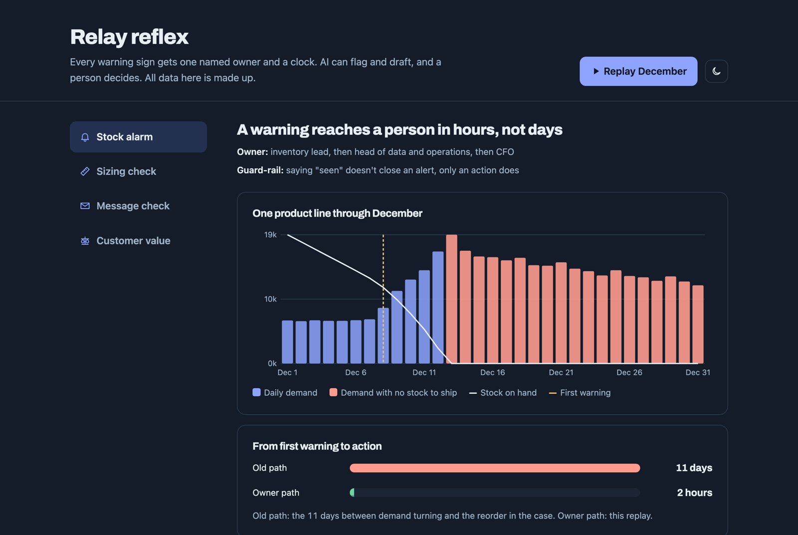

# AI everywhere, without automating the moat

**Summary.** A board told Relay, a fictional $600M activewear brand, to put AI everywhere. The brand's edge was its community, and the roles most exposed to AI were the ones holding that community together. I worked out where AI should act and where people must stay in charge, and built a demo of the core fix: every warning gets one named owner and a clock, AI can flag and draft, and a person decides.

[Live demo](https://lorisca-analytics.github.io/relay-ai-transformation/) · [How to run](#how-to-run) · [Decisions and what I turned down](DECISIONS.md)



## Problem

Relay grew on 1,500 ambassadors who led run clubs and events. Then an AI-first rival started winning on speed and price, and the board said "AI everywhere, by Friday."

In December a campaign pushed demand on one product past its stock. The warning was visible early, in a sales feed nobody owned, a weekly report 4 of its 11 readers opened, and three support tickets with no way up. It took 11 days to reorder. About 3,000 customers waited into January. Nobody failed at their own job. The handoffs failed.

About 180 roles did routine language work like support triage, order issues and copy. That's the work AI takes first, and the same people gave the brand its human feel.

## Inputs

The case material: a data room with finance, operations, community, people and governance reports, weekly briefings, and executives I could question. The demo in this repo runs on made-up data shaped like the case.

## Discovery

- The December failure wasn't forecasting. Every team acted on what it could see, and nothing connected them.
- AI already touched customers. The sizing tool recommended sizes to every shopper and was worse for plus sizes, with no owner.
- The dashboard counted popularity (followers, launches) instead of health.

## Execution

I questioned every executive before each major call. The calls:

1. **Turn down a $2.8M vendor engine.** Its contract let the vendor train on customer data for its other clients. Build the alarm first.
2. **Repair in private, then speak.** After a marketing group sent thousands of AI messages in a real ambassador's voice, fix it with her and the community before any public statement.
3. **Measure health, not popularity.** Three measures, each with an owner, the decision it drives and a guard-rail against gaming.
4. **Fix the risk, don't ban the capability.** The founder wanted "no AI touches a customer". A ban hides the sizing tool's bias. An owner, a bias check and a human override fix it.

Then I rebuilt the prototype as the demo in this repo. It has four parts:

| Part | What it shows | Owner |
|---|---|---|
| Stock alarm | Replays December. The first warning opens an alert with a clock to answer and a clock to act. "Seen" doesn't close it, only an action does. Ignored alerts move up the chain | Inventory lead, then head of data and operations, then CFO |
| Sizing check | Return rate by size. A gap over 5 points between plus and standard sizes pauses the fit tool for review | Data lead and merchandising lead |
| Message check | AI drafts pass five rules before they can send, including "never in a real person's voice" and "a person approved it". Rules, not AI | Person on shift |
| Customer value | Value per dollar spent by channel, before and after returns, against a 3.0x target | CFO |

## Results

- A plan that says which work AI takes, which stays with people, and who owns each call.
- A tested demo: a warning that took 11 days in the case reaches a named person in hours.
- Next step I'd recommend: give the alarm a named owner in week one, then put the three measures on the board report.

The team joined the final video presentation.

## How to run

```bash
python3 -m http.server 8000
```

Open http://localhost:8000.

```bash
node --test
```

runs the 30 tests (Node 18 or later, no installs).

## Limits

- The demo data is made up. The numbers in this README come from the case.
- The message rules catch obvious cases only, so a person still approves every message.
- The customer-value view depends on a return-cost assumption you can change on the page.
