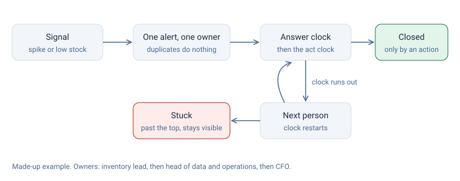

# How it was solved, and why

The README tells the story and [DECISIONS.md](DECISIONS.md) lists the options turned down. This file connects each part of the tool to the problem it answers.

| Problem in the case | What the tool does | Where in the code |
|---|---|---|
| A December warning sat 11 days in places nobody owned | Every signal type must be on a routing table with an owner before it can fire | `src/routes.js` |
| Reports got opened and not acted on | Two clocks: one to answer, one to act. "Seen" doesn't close an alert | `src/reflex.js`, `tick()` |
| Escalation depended on someone noticing | Overdue alerts move up the chain on their own and end as "stuck", never dropped | `src/reflex.js` |
| The same signal showed up in several feeds | Events carry ids, so a repeat changes nothing | `src/reflex.js`, `apply()` |
| The sizing tool was worse for plus sizes and had no owner | Return gap by size, with a 5-point line that pauses the fit tool for review | `src/sizing.js` |
| AI-written messages went out in an ambassador's voice | Rules every AI draft passes, and a person must approve it | `src/messages.js` |
| Channels looked cheap until returns were counted | Value per dollar by channel, before and after returns, against a 3.0x target | `src/value.js` |

Every rule above has a test in `test/`.
